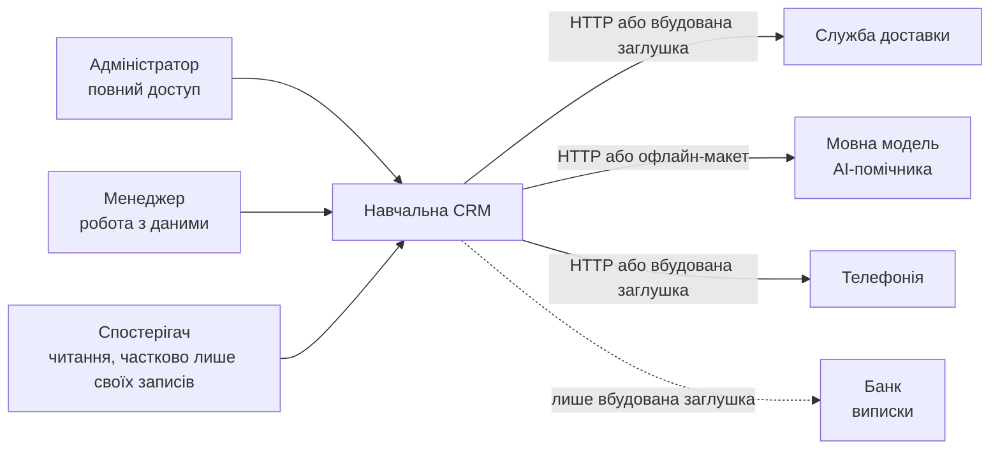
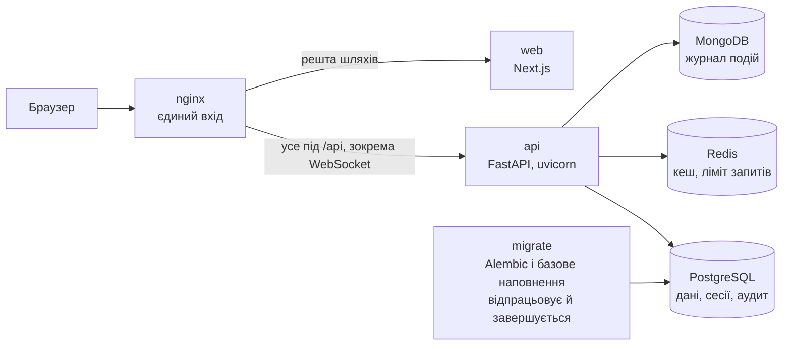
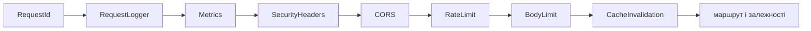
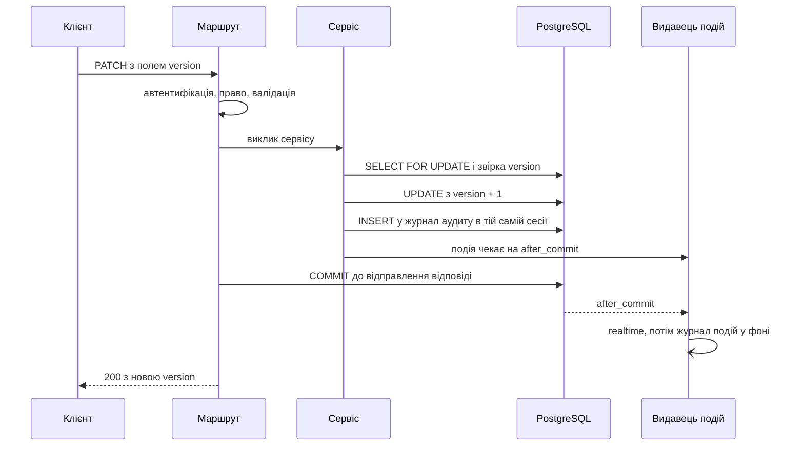
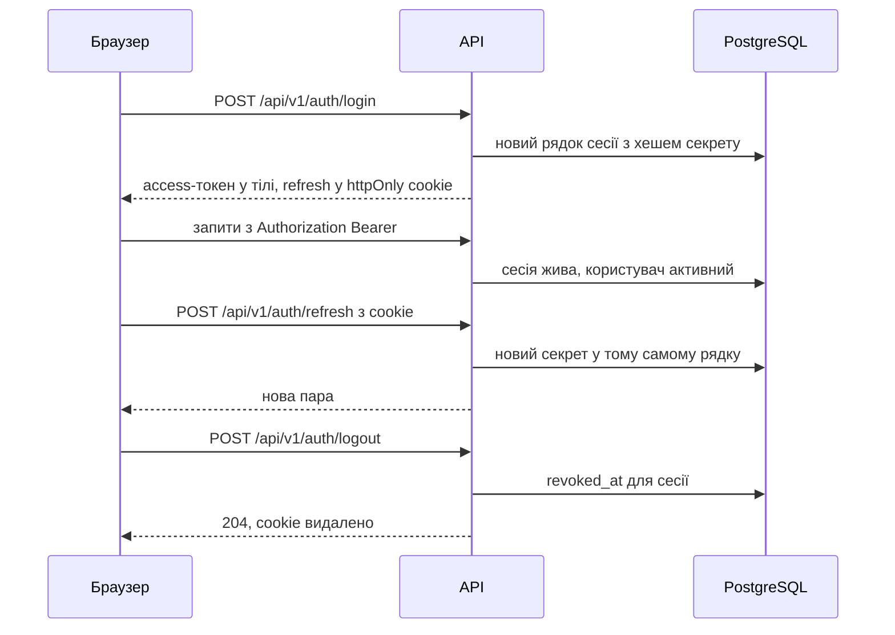

# Архітектура

Цей документ — карта країни, а не атлас. Він пояснює, з яких частин складається
система, де в коді шукати кожну з них і яких правил дотримується весь код. Що
саме робить окрема функція, підкаже сам код; цей файл підкаже, яку функцію
відкрити.

Як запустити систему — у [README.md](README.md). Щоденна робота з кодом, тести,
міграції й змінні оточення — у [docs/development.md](docs/development.md).
Чому рішення ухвалено саме так — в архітектурних рішеннях
[docs/adr/](docs/adr/README.md).

## Огляд з висоти

Навчальна CRM для невеликої торговельної компанії. Вона веде клієнтів і угоди,
каталог товарів, замовлення й склад, звернення клієнтів і журнал дзвінків,
банківські надходження та їх зведення із замовленнями, а поверх цього будує
звіти. Зміни бізнес-записів потрапляють у журнал аудиту, а частина екранів
оновлюється за подіями реального часу без перезавантаження сторінки.

Користуються системою працівники компанії з різними правами: від повного
доступу до читання лише власних записів. Доступ описується дозволами виду
`ресурс:дія` з обсягом «усі записи» або «лише свої»; ролі — це набори таких
дозволів, і їх можна створювати, не змінюючи коду.

Технічно це веб-клієнт на Next.js, HTTP API на FastAPI і сховища: PostgreSQL
для даних, Redis для кешу й обліку частоти запитів, MongoDB для журналу
доменних подій. Перед усім стоїть nginx.

## Контекст

Хто користується системою і з якими зовнішніми системами вона говорить.



Ролі на схемі — ті, що створює базове наповнення бази; облікові записи до них
перелічені в README. Інші ролі адміністратор створює через API.

Жодна зовнішня система не потрібна, щоб запустити систему й пройти всі
сценарії. Кожна інтеграція схована за інтерфейсом, і поруч лежить детермінована
заміна, яка відповідає тим самим форматом:

| Зовнішня система | Що з нею робить CRM | Без налаштування | Що вмикає справжній обмін |
|---|---|---|---|
| служба доставки | розрахунок вартості, створення відправлення, його статус | заглушка в `integrations/delivery/stub_transport.py` | `DELIVERY_BASE_URL` |
| мовна модель | переказ угоди, класифікація звернення | офлайн-макет у `ai/mock_provider.py` | `AI_ENDPOINT_URL` |
| телефонія | імпорт журналу дзвінків разом із посиланнями на записи розмов | заглушка в `calls/stub_provider.py` | `CALL_PROVIDER_BASE_URL` |
| банк | імпорт виписки | заглушка в `finance/stub_provider.py` | адаптера до справжнього банку немає |

Шляхи в таблиці — відносно `backend/app/modules/`. Змінна `INFRA_PROFILE=offline`
примусово вмикає всі заміни разом, хоч би що стояло в інших змінних
(`backend/app/infra_profile.py`).

## Контейнери

Що працює, коли система запущена повністю (`uv run poe docker:all` або
`docker:prod`).



- **nginx** (`etc/nginx/nginx.conf`) — один порт назовні. Шляхи під `/api/`
  ідуть до `api`, окреме правило для `/api/v1/realtime` зберігає заголовки
  WebSocket, усе інше йде до `web`.
- **web** (`frontend/`) — зібраний Next.js. Клієнт завжди звертається до свого ж
  джерела за відносним шляхом `/api/...`; через nginx такий запит іде просто до
  `api`. Якщо відкрити `web` напряму, він сам пересилає `/api` на `api` через
  `rewrites` у `frontend/next.config.mjs`.
- **api** (`backend/`) — увесь HTTP API, документація, проби здоров'я, метрики
  й канал подій реального часу.
- **migrate** — зібраний з того самого `backend/`, що й `api`: накочує міграції
  (`alembic upgrade head`) і запускає базове наповнення, після чого
  завершується. `api` стартує лише після його успіху.
- **PostgreSQL** — єдине джерело істини: бізнес-дані, користувачі, ролі, сесії,
  журнал аудиту.
- **Redis** — кеш і лічильники частоти запитів. Його втрата робить систему
  повільнішою, але не неправильною.
- **MongoDB** — журнал доменних подій із терміном зберігання. Доповнює аудит,
  але не замінює його.

Коли API запущено на машині (`local:api`), а клієнт — `local:web`, nginx не
бере участі: клієнт на порту 3000 пересилає `/api` на API через `rewrites` у
`frontend/next.config.mjs`.

## Карта коду

```
backend/
  app/
    main.py            точка входу: налаштування → контейнер → застосунок
    container.py       корінь композиції: будує весь граф об'єктів один раз
    factory.py         збирає FastAPI: middleware, обробники помилок, маршрути, OpenAPI
    lifespan.py        підключення на старті й акуратна зупинка
    infra_profile.py   одне рішення «заміни чи справжні залежності»
    core/              спільне ядро без бізнес-логіки
    db/                моделі SQLAlchemy, типи колонок, сесія
    modules/<домен>/   доменні модулі
    events/            доменні події: публікація після commit, журнал у MongoDB
    realtime/          WebSocket-шлюз і теми
    cache/             клієнт Redis і фасад кешу
    middleware/        middleware HTTP-конвеєра
    health/            проби live / startup / ready / info
    observability/     метрики Prometheus
  migrations/          Alembic
  scripts/             базове й демонстраційне наповнення, експорт OpenAPI
  tests/               unit, contract, integration
  openapi.json         закомічений опис API
frontend/              веб-клієнт
etc/nginx/             конфігурація проксі
scripts/stack.py       реалізація команд uv run poe …
```

### Анатомія доменного модуля

Кожен модуль у `backend/app/modules/<домен>/` складений однаково, і читати його
варто в цьому порядку:

1. `router.py` — HTTP-поверхня: шляхи, перевірка права через
   `require_permission`, оголошені відмови `refusals(...)`, загортання
   відповіді в `Envelope`.
2. `service.py` — бізнес-правила: запити до бази, перевірка `version`, запис
   аудиту, оголошення події.
3. `schemas.py` — Pydantic-моделі входу й виходу; саме з них генерується опис
   API.
4. `types.py` — коди помилок, назви дій аудиту, внутрішні структури.
5. `__init__.py` — фасад: що модуль віддає назовні, зазвичай разом із
   `create_<домен>_router()`.

Додаткові файли з'являються там, де в модуля є своя механіка:
`state.py` / `transition.py` — автомат станів, `money.py` — арифметика сум,
`provider.py` + `stub_provider.py` / `http_provider.py` — зовнішня система за
інтерфейсом, `dependencies.py` — залежності, які імпортують інші модулі.

Модулі не імпортують контейнер. Сесію бази, кеш, видавця подій і налаштування
вони отримують через залежності FastAPI, а про журнал подій і WebSocket не
знають зовсім: для них існує лише видавець. Усі роутери монтуються під
`/api/v1/<домен>` у `container.py`.

### Доменні модулі

| Модуль | Що робить | Звідки почати |
|---|---|---|
| `auth` | вхід, оновлення й завершення сесії, поточний користувач; дає іншим модулям `CurrentAuth` | `service.py`, `dependencies.py` |
| `rbac` | ролі, дозволи `ресурс:дія` з обсягом; залежність `require_permission` для роутерів | `dependencies.py`, `service.py` |
| `users` | облікові записи, їхні ролі, деактивація, перегляд і відкликання сесій | `service.py` |
| `contacts` | довідник людей і компаній, з якими працює організація | `service.py` |
| `deals` | воронка продажів; стадія угоди змінюється лише окремою дією за правилами автомата | `transition.py`, `state.py`, `service.py` |
| `products` | каталог товарів, з якого рахуються позиції замовлень | `service.py` |
| `orders` | замовлення з позиціями й сумами; зміна статусу резервує, видає або повертає товар на складі | `transition.py`, `stock.py`, `money.py`, `service.py` |
| `warehouse` | склади, рівні запасів і журнал рухів; реалізує складський порт для замовлень | `operations.py`, `service.py` |
| `helpdesk` | звернення клієнтів; статус змінюється окремою дією, з історією переходів | `transition.py`, `service.py` |
| `calls` | журнал дзвінків: імпорт від провайдера телефонії, прив'язка до контакту чи угоди, посилання на запис розмови | `provider_factory.py`, `service.py` |
| `finance` | банківські виписки й транзакції, зведення надходжень із замовленнями, фінансовий підсумок | `matching.py`, `service.py` |
| `integrations` | доставка: розрахунок вартості, відправлення, статус; повтори й запобіжник від збоїв перевізника | `delivery/client.py`, `delivery/factory.py`, `service.py` |
| `ai` | AI-помічник: переказ угоди й класифікація звернення | `provider_factory.py`, `service.py` |
| `settings` | налаштування організації: закритий реєстр ключів із типами й типовими значеннями | `registry.py`, `service.py` |
| `analytics` | звіти лише для читання поверх робочих таблиць і їх вивантаження; читаються через кеш | `service.py`, `export/` |
| `audit` | журнал аудиту: запис у транзакції того, хто змінює, і читання історії | `service.py` |

### Спільні частини

| Де | Що там |
|---|---|
| `app/core/settings.py` | єдина перевірена модель конфігурації; збирає адреси сховищ із частин |
| `app/core/errors.py`, `handlers.py`, `responses.py` | ієрархія `AppError`, обробники винятків, конверти відповідей і помилок |
| `app/core/openapi.py`, `api_docs.py` | оголошені відмови маршрутів, правило `operationId`, Swagger UI без CDN |
| `app/core/security.py` | хешування паролів і access-токени |
| `app/core/filters.py`, `pagination.py`, `paged_query.py` | фільтри списків і посторінкова вибірка |
| `app/core/serializers.py` | формат дат і грошей на дроті |
| `app/core/reporting.py` | звітне вікно за замовчуванням |
| `app/db/` | декларативна база з правилом іменування обмежень, моделі, тип `Money`, сесія на запит |
| `app/events/` | `DomainEventSubject`, відкладена до commit публікація, журнал у MongoDB з TTL і очищенням чутливих полів |
| `app/realtime/` | WebSocket-шлюз, автентифікація рукостискання, словник тем |
| `app/cache/` | клієнт Redis із префіксом ключів, фасад кешу, що не ламає запит, пробу готовності |
| `app/middleware/` | конвеєр HTTP: кореляційний id, лог, метрики, заголовки безпеки, ліміт частоти, ліміт тіла, скидання кешу |
| `app/health/` | проби й фаза життєвого циклу процесу |
| `app/observability/` | реєстр і ендпоінт метрик Prometheus |

### Тести

`backend/tests/unit` — модулі й увесь застосунок у процесі, без сховищ.
`backend/tests/contract` — форма відповідей, що виходить з процесу: конверти,
коди, формат дат і грошей. `backend/tests/integration` — сценарії проти
справжніх PostgreSQL, Redis і MongoDB в окремих тестових базах; звичайний
`pytest` їх не збирає, для них є окрема команда.

### Веб-клієнт

`frontend/src/app/(auth)/<розділ>/` — розділи за входом, кожен з однаковим
набором: сторінка, `*.service.ts` (чистий HTTP), `*.queries.ts`
(TanStack Query), типи й валідація. `frontend/src/app/(non-auth)/` — вхід.
`frontend/src/shared/api/http.ts` — HTTP-клієнт із токеном у пам'яті й
оновленням сесії; `shared/realtime/` — клієнт каналу подій, який за подіями
скидає кеш запитів; `src/templates/` — оболонка, провайдери, навігація з
перевіркою прав.

## Потоки даних

### Шлях запиту

Middleware реєструються в `app/factory.py` знизу вгору, тож запит проходить їх у
зворотному порядку:



- **RequestId** — бере `X-Request-Id` клієнта, якщо той безпечний, або створює
  новий; той самий id потрапляє в кожен рядок логу, у заголовок і в тіло
  помилки.
- **RequestLogger** — один рядок на запит після того, як відомий статус.
- **Metrics** — стоїть до всіх запобіжників, щоб у лічильники потрапили й
  відхилені запити.
- **SecurityHeaders** — базові заголовки безпеки; для сторінки документації
  політика скриптів пом'якшена.
- **CORS** — дозволені джерела з `CORS_ORIGINS`, з cookie.
- **RateLimit** — ковзне вікно в Redis: загальний бюджет на кожен запит і менший
  на `/api/v1/auth`. Ключ — користувач за дійсним access-токеном або адреса
  клієнта. Якщо Redis недоступний, запит пропускається. У середовищі `test`
  ліміт не підключається.
- **BodyLimit** — відсікає тіло, більше за `JSON_BODY_LIMIT_BYTES`.
- **CacheInvalidation** — після успішного запису скидає кеш звітів (див. нижче).

Далі FastAPI розв'язує залежності маршруту: сесію бази, автентифікацію
(`CurrentAuth`), право (`require_permission` повертає обсяг), валідацію
параметрів і тіла. Помилка валідації — це 400, а не 422. Будь-який `AppError`
перетворюється обробником з `app/core/handlers.py` на єдиний конверт помилки.

### Запис: транзакція, аудит, подія після commit



1. Сесія відкривається залежністю `SessionDep` (`app/modules/auth/dependencies.py`,
   `app/db/session.py`) і комітиться, коли обробник повернувся без винятку, —
   ще до першого байта відповіді. Виняток означає відкат усього.
2. Сервіс перевіряє `version`, яку прислав клієнт; розбіжність — 409 з кодом
   `<РЕСУРС>_CONCURRENT_MODIFICATION`.
3. Запис аудиту (`app/modules/audit/service.py`) іде на тій самій сесії, тож
   зміна й її слід комітяться або відкочуються разом.
4. Подію сервіс оголошує одразу, але `publish_after_commit`
   (`app/events/dispatch.py`) відкладає доставку до `after_commit` сесії.
   Відкочена транзакція подій не породжує.
5. `FanOutPublisher` (`app/container.py`) доставляє подію у фоновій задачі:
   спершу підписникам WebSocket, потім у журнал MongoDB. Збій підписника не
   доходить до клієнта, чия транзакція вже закомічена.

### Читання звітів через кеш

`AnalyticsService` (`app/modules/analytics/service.py`) будує звіт через
`cache.remember(key, ttl, ...)`: є значення в Redis — віддає його, немає —
рахує запит до PostgreSQL і кладе результат на `CACHE_TTL_SECONDS`. Ключ
містить назву звіту й нормалізовані параметри
(`app/modules/analytics/cache_keys.py`).

Скидання грубе й навмисне: `CacheInvalidationMiddleware`
(`app/middleware/cache_invalidation.py`) після кожного успішного `POST`, `PUT`,
`PATCH` чи `DELETE` (крім `/api/v1/auth`) видаляє весь простір ключів
аналітики. Відстежувати, який запис впливає на який звіт, не потрібно, а
клієнт, що читає одразу після свого запису, не побачить старих чисел.

Інші кеші скидаються адресно в сервісах: дозволи користувача — під час зміни
ролей і користувачів (`rbac/service.py`, `users/service.py`), налаштування
організації — під час їх запису (`settings/service.py`).

Фасад кешу (`app/cache/service.py`) ніколи не кидає винятків: помилка читання —
це промах, помилка запису — пропущений запис.

### Підписка на події реального часу

1. Клієнт відкриває WebSocket на `WS_PATH` (типово `/api/v1/realtime`). Токен
   доступу передається підпротоколом `bearer, <токен>` або заголовком
   `Authorization`; рядок запиту не читається ніколи (`app/realtime/auth.py`).
2. Шлюз (`app/realtime/gateway.py`) перевіряє токен тим самим
   `AuthService.authenticate`, що й HTTP; невдача закриває з'єднання.
3. Клієнт надсилає `{"type": "subscribe", "topic": "..."}`. Тема — це або
   колекція (`deals`, `orders`), або окремий запис `entity:<тип>:<id>`
   (`app/realtime/topics.py`). Невідома назва — помилка `UNKNOWN_TOPIC`.
4. `can_subscribe` у `app/container.py` визначає ресурс теми й вимагає дозволу
   `read` на нього.
5. Закомічена зміна йде в тему колекції, якщо вона є, і в тему запису; клієнт за подією
   скидає відповідні запити й перечитує дані через HTTP.

Реєстр підписок живе в пам'яті процесу.

## Сесії та автентифікація



- **Вхід** (`app/modules/auth/service.py`). Відсутній користувач, невірний
  пароль і деактивований обліковий запис дають однакову відповідь 401
  `INVALID_CREDENTIALS`. Успіх створює рядок у таблиці сесій.
- **Access-токен** — JWT на 15 хвилин, підписаний `JWT_ACCESS_SECRET`, з
  ідентифікаторами користувача й сесії. Клієнт тримає його лише в пам'яті
  (`frontend/src/shared/api/http.ts`), не в `localStorage`. На кожен запит API
  перевіряє не тільки підпис, а й те, що сесія не відкликана й не прострочена,
  а користувач активний, — тому вихід і відкликання діють одразу, а не після
  закінчення токена.
- **Refresh-токен** — непрозорий рядок `<id сесії>.<секрет>`; у базі лежить
  лише хеш секрету. Він живе 7 днів у cookie `refresh_token` з `HttpOnly`,
  `SameSite=Lax`, шляхом `/api/v1/auth` і прапорцем `Secure` у production. До
  звичайних запитів cookie не додається, а скрипт на сторінці прочитати його не
  може.
- **Ротація.** `refresh` записує новий секрет у той самий рядок сесії. Старий
  refresh-токен перестає працювати, щойно законний власник оновився; кількість
  сесій від оновлень не росте. Клієнт, отримавши 401, оновлює сесію один раз
  для всіх паралельних запитів і повторює запит.
- **Вихід** ставить сесії `revoked_at` і видаляє cookie. Вихід без дійсного
  токена — не помилка.
- **Відкликання.** Адміністратор бачить сесії користувача й відкликає будь-яку
  з них (`users/router.py`). Деактивація користувача відкликає всі його сесії й
  скидає кеш дозволів.

### RBAC × обсяг

Дозвіл — це пара `ресурс:дія` (`products:write`, `ai:use`), яку роль видає з
обсягом `ALL` або `OWN` (`app/db/enums.py`, `PermissionScope`). Дозволи
користувача кешуються в Redis і скидаються під час зміни ролей.

`require_permission(resource, action)` (`app/modules/rbac/dependencies.py`)
відмовляє 403 лише тоді, коли дозволу немає зовсім, і **повертає обсяг**
обробнику. Звузити вибірку до власних записів може тільки сервіс, бо лише він
знає, хто власник запису; для цього є `ensure_scope_covers` і
`ensure_scope_all`. Тобто перевірка права відбувається в роутері, а застосування
обсягу — у сервісі, і забути другу половину — найпростіший спосіб відкрити чужі
записи.

## Наскрізні інваріанти

- **Один конверт.** Успіх — `{"data": ...}`, сторінка списку —
  `{"data": {"items", "page", "pageSize", "total"}}`, помилка —
  `{"error": {"code", "message", "details"}, "requestId"}`
  (`app/core/responses.py`). Обробник ніколи не збирає зовнішній об'єкт сам.
- **camelCase на дроті, snake_case у Python.** Перетворення оголошено один раз у
  `CamelModel`.
- **Гроші — десятковими рядками.** У базі `Numeric` з точністю до копійки, у
  Python `Decimal`, у JSON рядок. Збережена сума йде найкоротшим точним записом
  (`"12.5"`, `"2400"`), цифри звітів — рівно з двома знаками (`"12.50"`)
  (`app/core/serializers.py`). Float сум не торкається ніде.
- **Оптимістичне блокування.** Записи, які люди редагують одночасно, мають
  `version`; кожна зміна приходить з версією, яку бачив клієнт, і збільшує її.
  Невідповідність — 409. Видалення такого запису передає версію в рядку запиту.
- **М'яке видалення.** Видалення ставить `deleted_at`; такі записи зникають зі
  списків і звітів, але лишаються для історії та зв'язків.
- **Аудит у тій самій транзакції.** Сервіс, що пише слід, пише його на своїй
  сесії; слід і зміна не можуть розійтися.
- **Події — тільки після commit.** Підписники ніколи не чують про зміну, яку
  потім відкотили, і не можуть зламати закомічену операцію.
- **Стани змінюються окремою дією.** Стадія угоди, статус замовлення й
  звернення не редагуються як звичайне поле: для них є окремий маршрут і автомат
  дозволених переходів.
- **Деградовані залежності.** Redis і MongoDB не роблять запис неможливим.
  Недоступний кеш — промах і повільніший запит; недоступний Redis для ліміту —
  запит пропускається; недоступний журнал подій — подія губиться для журналу, а
  операція й аудит лишаються. На старті API не падає через MongoDB. Проба
  `/api/health/ready` при цьому чесна: кеш у ній некритичний (статус
  `degraded`, HTTP 200), а журнал подій і база критичні (HTTP 503).
- **Одне місце конфігурації.** Змінні оточення читає лише `Settings`
  (`app/core/settings.py`); невалідне значення зупиняє старт із переліком
  помилок, а не ламає запит пізніше. Винятки — змінні `SEED_*`, які читає лише
  `scripts/seed.py`, і `*_TEST` для інтеграційних тестів.
- **Залежності спрямовані всередину.** Модулі не імпортують контейнер; зовнішні
  системи доступні тільки через інтерфейс, який реалізує вбудована заміна, а
  де він є, і справжній адаптер.

### Чого система свідомо не робить

- Немає справжнього production: розгортання в CI — імітація на тимчасовій машині
  (`docs/deployment.md`).
- Немає черги повідомлень. Події доставляються в межах процесу без гарантії
  доставки; надійна історія змін — журнал аудиту в PostgreSQL.
- Журнал подій не читається через API: це сховище для розбору, а не джерело
  для екранів.
- Канал реального часу тримає підписки в пам'яті одного процесу.
- Немає реєстрації, відновлення пароля, листів і SMS. Облікові записи створює
  адміністратор.
- Немає фонових задач за розкладом: усе відбувається у відповідь на запит.
- Немає справжнього обміну з банком — лише вбудована виписка.
- Одна організація на інсталяцію.

## Опис API (OpenAPI)

Опис генерується з коду, а не пишеться руками:

- **З маршрутів і моделей.** Шляхи, параметри, тіла запитів і успішні відповіді
  FastAPI бере з сигнатур обробників і Pydantic-моделей у `schemas.py`.
  Назва операції будується одним правилом із методу й повного шляху
  (`operation_id` у `app/core/openapi.py`): `GET /api/v1/products/{id}` →
  `get_api_v1_products_id`.
- **Відмови — руками, поруч із маршрутом.** Чим може відмовити сервіс (401,
  403, 404, 409 …), генератор знати не може: це винятки глибоко в коді. Тому
  кожен маршрут перелічує їх сам через `responses=refusals(...)`, і рецензент
  бачить шлях і його відмови поруч. Тексти статусів живуть у
  `RESPONSE_DESCRIPTIONS`.
- **Спільне додає фабрика.** `_install_openapi` в `app/factory.py` додає 400 і
  500 з конвертом помилки до кожної операції та прибирає згенеровану 422, якої
  API ніколи не віддає.
- **Закомічений `backend/openapi.json`.** Його пише
  `uv run python -m scripts.export_openapi` (з теки `backend`) з тієї самої
  фабрики, з фіксованими налаштуваннями, тож файл однаковий на кожній машині.
  Тест `tests/unit/test_openapi_document.py` падає, якщо файл розійшовся з кодом,
  якщо змонтовано маршрут без опису або описано маршрут, якого немає.
- **Swagger UI** — `/api/docs`, документ — `/api/openapi.json`. Обидва
  вимикаються в production, якщо явно не задано `API_DOCS_ENABLED=true`.

## Середовища

`APP_ENV` приймає `development`, `test` або `production`, і від нього залежать
кілька конкретних речей:

| | `development` | `test` | `production` |
|---|---|---|---|
| Де | `local:api`; `docker:all` (через `compose.override.yaml`) | `pytest`: unit-тести будують налаштування самі, інтеграційні виводять їх з `.env` | `docker:prod` (лише `compose.yaml`), імітоване розгортання в CI |
| Логи | кольорові, для людини | JSON, рядок на подію | JSON, рядок на подію |
| SQL у лог | так | ні | ні |
| Перезапуск при збереженні | так | — | ні, зібраний образ |
| Swagger і `/api/openapi.json` | так | так | ні, якщо не `API_DOCS_ENABLED=true` |
| Текст неочікуваної помилки 500 | повідомлення винятку | повідомлення винятку | лише «Internal server error» |
| Cookie сесії `Secure` | ні | ні | так |
| Ліміт частоти запитів | так | ні | так |
| Пауза перед зупинкою | `SHUTDOWN_GRACE_PERIOD_MS` | без паузи | `SHUTDOWN_GRACE_PERIOD_MS` |
| Базове наповнення | так | так | лише з `SEED_ALLOW_PRODUCTION=true` |

Звідки береться конфігурація:

- **`.env` у корені** — спільне для Docker Compose і для API на машині:
  середовище, порти, назви й паролі баз.
- **`backend/.env`** — лише бекенд: секрети, CORS, ліміти, кеш, інтеграції.
- **`compose.yaml`** описує систему так, як вона працювала б на сервері, і
  ставить `APP_ENV=production` та імена сервісів як хости сховищ.
  **`compose.override.yaml`** поверх нього перемикає `api` і `migrate` у
  `development` і монтує код.
- Тестового файла оточення немає: інтеграційні тести беруть ті самі `.env` і
  самі виводять тестові бази `<назва>_test` та префікс Redis `crm-test:`.

Повна таблиця змінних — у [docs/development.md](docs/development.md#змінні-оточення-бекенда).

## Глосарій

| Термін | Що означає тут |
|---|---|
| контакт | людина або компанія, з якою працює організація |
| угода | потенційний продаж; рухається стадіями `LEAD` → `QUALIFIED` → `PROPOSAL` → `WON` або `LOST` |
| власник запису | працівник, відповідальний за угоду, контакт, замовлення; від нього залежить обсяг `OWN` |
| товар | позиція каталогу з артикулом (SKU) і ціною |
| замовлення | продаж із позиціями; статуси `DRAFT` → `CONFIRMED` → `PAID` → `FULFILLED`, а `CANCELLED` — з будь-якого статусу до видачі |
| позиція замовлення | рядок замовлення: товар, кількість, ціна |
| склад за замовчуванням | склад, з якого працюють замовлення; налаштування організації `warehouse.defaultCode` |
| рівень запасу | скільки товару є на складі і скільки з того зарезервовано |
| рух запасу | запис у журналі складу: надходження, видача, резерв, зняття резерву, коригування |
| резерв | товар, обіцяний підтвердженому замовленню; знімається скасуванням або перетворюється на видачу |
| звернення | запит клієнта до підтримки з каналом, пріоритетом і статусом `NEW` … `CLOSED` |
| дзвінок | запис журналу телефонії; факти дає провайдер, люди додають зв'язок із контактом чи угодою |
| виписка | банківський звіт за період, імпортований як ціле |
| транзакція | рядок виписки: надходження або списання |
| зведення | зв'язок надходження із замовленням, яке воно оплачує; буває ручним і автоматичним, а стан `SUGGESTED` означає кандидата, якого має підтвердити людина |
| налаштування організації | ключ із закритого реєстру з типом і типовим значенням |
| звітне вікно | період, який звіт бере, коли параметри дат не задано |
| дозвіл | право `ресурс:дія`, видане роллю |
| обсяг | ширина дозволу: `ALL` — усі записи, `OWN` — лише свої |
| роль | названий набір дозволів з обсягами |
| сесія | рядок у базі, до якого прив'язані refresh- і access-токени; її можна відкликати |
| access-токен | короткоживучий JWT для заголовка `Authorization` |
| refresh-токен | довгоживучий непрозорий токен у httpOnly cookie, яким оновлюють пару |
| версія (`version`) | лічильник змін запису для оптимістичного блокування |
| м'яке видалення | позначка `deleted_at` замість фізичного видалення |
| журнал аудиту | історія змін у PostgreSQL: хто, що, коли, до й після; пишеться в транзакції зміни |
| доменна подія | повідомлення «запис змінено», яке розсилається після commit |
| журнал подій | сховище доменних подій у MongoDB з терміном зберігання |
| тема | канал підписки WebSocket: колекція (`deals`) або запис (`entity:deal:<id>`) |
| конверт | обов'язкова зовнішня форма відповіді: `data` або `error` з `requestId` |
| відмова | оголошена в описі API відповідь 4xx/5xx маршруту з кодом помилки |
| заглушка, макет | детермінована заміна зовнішньої системи, яка працює без мережі |
| інфраструктурний профіль | `INFRA_PROFILE`: `offline` вмикає всі заміни разом |
| запобіжник (circuit breaker) | після серії збоїв перевізника тимчасово перестає до нього звертатися |

## Що читати далі

- [README.md](README.md) — запуск, команди, адреси, облікові записи.
- [docs/development.md](docs/development.md) — локальна розробка, тести,
  міграції, демонстраційні дані, змінні оточення.
- [docs/deployment.md](docs/deployment.md) — ланцюжок релізу й імітоване
  розгортання.
- [docs/adr/](docs/adr/README.md) — архітектурні рішення та їх причини.
- [CONTRIBUTING.md](CONTRIBUTING.md) — як запропонувати зміну.
