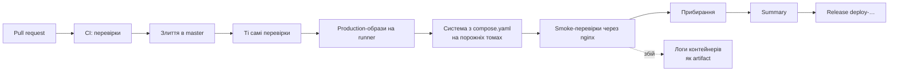

# Розгортання

Як зміна проходить шлях від pull request до «розгорнуто» і що в цьому шляху
справжнє, а що імітоване. Як внести зміну — у
[`CONTRIBUTING.md`](../CONTRIBUTING.md), локальна розробка — у
[`development.md`](development.md).

> **Це навчальний стенд.** Злиття в `master` проходить увесь ланцюжок
> розгортання, але система піднімається в тимчасовому середовищі на кілька
> хвилин і зникає. Справжнього production, користувачів і живих даних за ним
> немає.

## Ланцюжок



Два workflow:

| Файл | Коли запускається | Що робить |
|---|---|---|
| `.github/workflows/ci.yml` | pull request у `master` чи `develop` і кожен push у його гілку; push у `develop`; вручну (**Run workflow**); з `deploy.yml` | перевірки |
| `.github/workflows/deploy.yml` | push у `master`, тобто злиття pull request; вручну | перевірки, імітоване розгортання, реліз |

### 1. Pull request → перевірки

`ci.yml` запускає незалежні завдання: перевірки API (`check:api`), перевірки
веб-клієнта (`check:web`), інтеграційні тести на справжніх PostgreSQL, Redis і
MongoDB у service-контейнерах, звірку міграцій із моделями і збірку
production-образів (`docker:build`). Завдання `ci-success` зелене лише тоді,
коли зелені всі інші, тож саме його ставлять обов'язковою перевіркою для
`master`. Що робить кожне завдання і як відтворити його на машині — у
[`CONTRIBUTING.md`](../CONTRIBUTING.md#7-що-перевіряє-ci).

Новий push у гілку pull request чи в `develop` скасовує попередній незакінчений прогін. На
`master` кожен коміт отримує власний прогін, і нічого не скасовується.

### 2. Злиття в `master` → перевірки ще раз

`deploy.yml` спершу викликає `ci.yml` цілком. Окремого запуску `ci.yml` на push
у `master` немає: перевірки злитого коміту — перша частина розгортання. Якщо
вони червоні, до розгортання справа не доходить.

### 3. Production-образи на runner

Завдання **Simulated deployment** на чистій віртуальній машині GitHub:

1. `python3 scripts/stack.py setup` — створює `.env` і `backend/.env` із
   шаблонів, зі свіжими JWT-ключами. Це те саме, що отримує перший запуск на
   новій машині.
2. `python3 scripts/stack.py docker:build` — збирає production-образи. Образи
   лишаються на цьому runner і нікуди не публікуються.

### 4. Система з `compose.yaml` на порожніх томах

```bash
docker compose -f compose.yaml up -d --wait --wait-timeout 600 nginx
```

Лише `compose.yaml`, без `compose.override.yaml` для розробки, тобто
`APP_ENV=production`. Runner новий, тож усі томи порожні: контейнер `migrate`
застосовує всю історію міграцій (`alembic upgrade head`) і базове наповнення,
`api` стартує після нього, `nginx` — після того, як `api` і `web` пройшли свої
healthcheck. `--wait` повертає керування, коли nginx працює, тож зелений крок
означає, що всі healthcheck пройдено.

Локально те саме дає `uv run poe docker:prod`. Щоб і томи були порожні, як на
runner, спершу `uv run poe docker:clean`.

### 5. Smoke-перевірки через nginx

Кілька запитів, які людина зробила б першими, через опублікований порт nginx:

| Перевірка | Очікується |
|---|---|
| `GET /api/health/ready` | `200` |
| `GET /login` — сторінка входу веб-клієнта | `200` |
| `GET /api/v1/contacts` без токена | `401` |
| `POST /api/v1/auth/login` адміністратором із базового наповнення | `200` і access-токен |
| `GET /api/v1/contacts` з цим токеном | `200` |

Кожен результат іде в таблицю для Summary.

### 6. Логи при збої

Якщо впав будь-який крок, стан контейнерів і логи всього стека зберігаються як
artifact `deploy-logs` прогону на 7 днів.

### 7. Прибирання

У будь-якому разі, успішному чи ні:

```bash
docker compose -f compose.yaml --profile tools down --volumes --remove-orphans
```

Після прогону не лишається ні контейнерів, ні мережі, ні томів.

### 8. Summary

Сторінка прогону показує таблицю етапів (збірка образів, старт і healthcheck,
smoke-перевірки) з результатом кожного, таблицю smoke-перевірок і вердикт:
«passed» — цей коміт пішов би в роботу, «failed» — не пішов би, логи в
`deploy-logs`.

### 9. Release

Коміт, що пройшов розгортання, позначається GitHub Release з тегом
`deploy-<перші 12 символів коміту>` і автоматичними нотатками змін. Реліз не
позначається як «Latest». Це єдине завдання з правом запису в репозиторій
(`contents: write`). Якщо організація тримає токен лише для читання, воно падає
саме по собі й не змінює результату розгортання (`continue-on-error`). Ручний
запуск `deploy.yml` з іншої гілки реліз не створює.

## Чому тут немає справжнього production

Репозиторій — навчальний стенд, і кожен форк мусить проходити той самий
ланцюжок без жодних налаштувань. Тому в ньому немає того, що справжнє
розгортання потребує обов'язково:

- **сервера чи платформи**, куди виїжджає система і де вона живе довше за
  прогін;
- **реєстру образів**: тут образи збираються й гинуть на runner, а справжній
  ланцюжок публікує їх із тегом коміту, і сервер забирає саме їх;
- **секретів розгортання** в GitHub Environments (див. нижче);
- **окремого кроку міграцій** проти бази з живими даними. Тут міграції
  накочуються на порожню базу, а на справжній їх застосовують до перемикання
  трафіку, пишуть сумісними зі старою версією коду й мають резервну копію
  перед запуском;
- **моніторингу й сповіщень**: тут `/api/health/ready` після прогону ніхто не
  опитує, а `/api/metrics` без `METRICS_TOKEN` вимкнено;
- **відкату**: попередня версія образу, яку можна повернути однією дією, і
  правило, коли це робити.

Базове наповнення з демонстраційними обліковими записами працює й у production-режимі
лише тому, що це стенд: дозволяє це `SEED_ALLOW_PRODUCTION=true` у
`backend/.env.example`. Справжнє розгортання таких записів не створює.

Опис API в production вимкнений: `/api/docs` і `/api/openapi.json` типово
відсутні при `APP_ENV=production` і вмикаються лише явним
`API_DOCS_ENABLED=true` у `backend/.env`. Тому smoke-перевірки їх не
торкаються.

## Секрети

Workflow не потребують жодного секрету. Єдиний токен — автоматичний
`GITHUB_TOKEN`, лише для читання вмісту репозиторію (крім завдання релізу).

- **Паролі сховищ у CI** (`ci-only-password` у service-контейнерах) існують лише
  всередині runner і нічого поза ним не захищають.
- **Імітоване розгортання** бере паролі сховищ і демо-пароль із закомічених
  шаблонів `.env.example` і `backend/.env.example`, а JWT-ключі генерує `setup`
  наново на кожен прогін. Середовище живе кілька хвилин, сховища слухають лише
  `127.0.0.1` runner, і після прогону все знищується.
- **Форки.** Перевірки мусять працювати в кожному форку щойно після ввімкнення
  Actions. Секрети репозиторію у форк не копіюються, а pull request із форку в
  чужий репозиторій отримує токен лише для читання й не бачить секретів
  оригіналу. Workflow, якому потрібен секрет, у форку просто впав би.

У справжньому проєкті секрети не лежать ні в коді, ні в шаблонах:

- JWT-ключі, паролі баз, ключі інтеграцій (`DELIVERY_API_KEY`, `AI_API_KEY`,
  `CALL_PROVIDER_API_KEY`) зберігаються в **Settings → Secrets and variables →
  Actions**, а для розгортання — в секретах **GitHub Environment**
  (наприклад, `production`) з обов'язковим підтвердженням людиною перед
  запуском;
- workflow передає їх у крок розгортання через `${{ secrets.NAME }}`, а той — у
  змінні оточення сервера, не в образ;
- доступ до хмари — через OIDC замість довгоживучих ключів, а секрети мають
  власника й план заміни.
